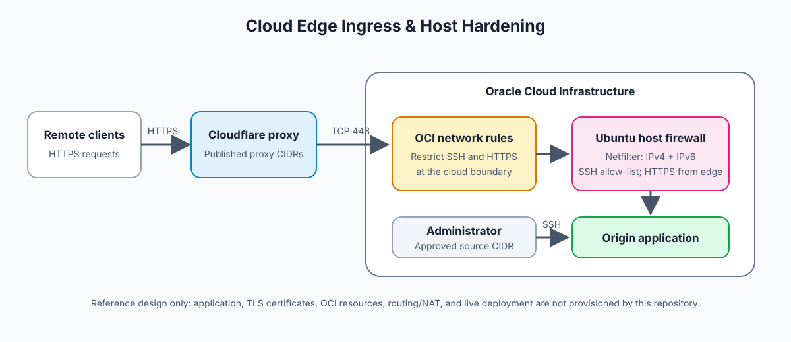

# Cloud Edge Ingress & Origin Hardening

An open-source reference architecture and Linux host baseline for protecting an Internet-facing application behind Cloudflare and Oracle Cloud Infrastructure (OCI) network controls.

## Architecture Overview



The design uses defense in depth. Cloudflare proxies public HTTPS requests, OCI network security rules restrict origin ingress to Cloudflare's published address ranges, and the Ubuntu host applies a second source-aware firewall policy. SSH is limited to explicitly approved administrator CIDRs. Direct Internet access to the origin is blocked when both the OCI and host allow-lists are configured consistently. See the [Cloudflare IP ranges](https://www.cloudflare.com/ips/) and [OCI network security groups](https://docs.oracle.com/en-us/iaas/Content/Network/Concepts/networksecuritygroups.htm) documentation when configuring the cloud boundary.

The repository provides the host firewall and kernel-tuning baseline, plus the deployment procedures below. Cloudflare settings, OCI network resources, the application, and origin TLS certificates are configured for the deployment environment.

## Security & Ingress Baseline

`configs/netfilter-hardening.sh` builds separate IPv4 and IPv6 rulesets and validates both with `iptables-restore --test` and `ip6tables-restore --test` before applying either. The managed `UER-INPUT` chain:

- Accepts loopback, established/related traffic, and ICMP/ICMPv6.
- Allows new SSH connections only from configured administrator CIDRs.
- Allows new TCP 443 connections only from configured edge-proxy CIDRs.
- Drops other inbound traffic. The script sets the IPv4 and IPv6 `INPUT` and `FORWARD` default policies to `DROP`.

Outbound policy remains unchanged. The script does not add NAT or forwarding allow-rules. Keep the OCI and host ingress allow-lists aligned and refresh Cloudflare ranges from its official IP address documentation. The firewall requires explicit IPv4 SSH and proxy CIDRs; IPv6 CIDRs are independently configurable. When IPv6 ingress is enabled, set both IPv6 allow-lists before deployment.

The ruleset is applied through the dedicated chain rather than flushing unrelated filter-table chains. Review existing firewall managers and other `INPUT` hooks before applying; this baseline owns the default `INPUT`/`FORWARD` policies and should not compete with another policy manager.

## Linux Kernel Network Tuning

`configs/sysctl-tuning.conf` provides a conservative origin-host profile:

- Selects `fq` with TCP BBR for congestion control when the running kernel supports BBR.
- Enables TCP Fast Open and configures keepalive and socket buffer limits for sustained connections.
- Enables SYN cookies and increases the SYN backlog to improve resilience under connection bursts.
- Disables IPv4 and IPv6 packet forwarding by default because this profile is for an origin host, not a transit router.

If the host has a separate routing role, enable forwarding only as part of a reviewed router configuration with matching firewall and routing rules. Applying forwarding sysctls alone does not implement routing or NAT.

## Deployment Runbook

### Prerequisites

- Ubuntu/Linux with Bash, `iptables`, `ip6tables`, and their `*-restore` commands.
- Root privileges and OCI serial-console or equivalent out-of-band recovery access.
- OCI network security rules allowing TCP 22 only from administrator CIDRs and TCP 443 only from Cloudflare's current proxy CIDRs.
- Valid host-specific IPv4 CIDRs for SSH and edge ingress. Configure IPv6 CIDRs too when IPv6 ingress is enabled.
- An application listening on TCP 443 with its origin TLS configuration installed.

Replace the documentation-only CIDR examples below with current, deployment-specific ranges. Never use `0.0.0.0/0` or `::/0` for SSH administration.

### Back up current state

Keep the current SSH session open and confirm out-of-band access before changing firewall policy. Save current rules and sysctl values outside the repository:

```bash
sudo sh -c 'iptables-save > /root/iptables.before'
sudo sh -c 'ip6tables-save > /root/ip6tables.before'

if sudo test -e /etc/sysctl.d/90-edge-routing.conf; then
  sudo cp -a /etc/sysctl.d/90-edge-routing.conf /root/90-edge-routing.conf.before
fi

sudo sh -c '
for key in net.ipv4.ip_forward net.ipv6.conf.all.forwarding net.core.default_qdisc \
  net.ipv4.tcp_congestion_control net.ipv4.tcp_fastopen net.ipv4.tcp_keepalive_time \
  net.ipv4.tcp_rmem net.ipv4.tcp_wmem net.core.rmem_max net.core.wmem_max \
  net.ipv4.tcp_syncookies net.ipv4.tcp_max_syn_backlog; do
  printf "%s = %s\n" "$key" "$(sysctl -n "$key")"
done > /root/edge-routing-sysctl.before
'
```

### Validate and apply host firewall

Export comma-separated CIDR allow-lists. The sample IPv4 ranges are reserved documentation ranges and are not deployment values:

```bash
export SSH_ADMIN_IPV4_CIDRS="198.51.100.25/32"
export EDGE_PROXY_IPV4_CIDRS="203.0.113.0/24"
export SSH_ADMIN_IPV6_CIDRS=""
export EDGE_PROXY_IPV6_CIDRS=""

sudo --preserve-env=SSH_ADMIN_IPV4_CIDRS,SSH_ADMIN_IPV6_CIDRS,EDGE_PROXY_IPV4_CIDRS,EDGE_PROXY_IPV6_CIDRS \
  bash configs/netfilter-hardening.sh --check
sudo --preserve-env=SSH_ADMIN_IPV4_CIDRS,SSH_ADMIN_IPV6_CIDRS,EDGE_PROXY_IPV4_CIDRS,EDGE_PROXY_IPV6_CIDRS \
  bash configs/netfilter-hardening.sh
```

`--check` validates the generated IPv4 and IPv6 rules without changing firewall state. The apply command installs the `UER-INPUT` chain, hooks it into `INPUT`, and sets both families' `INPUT` and `FORWARD` policies to `DROP`. Use `SSH_PORT` when SSH listens on a non-default port. Confirm access from an approved administrator address in a second session before closing the original one.

### Apply and verify kernel profile

```bash
sudo install -m 0644 configs/sysctl-tuning.conf /etc/sysctl.d/90-edge-routing.conf
sudo sysctl --system

sysctl net.ipv4.ip_forward net.ipv6.conf.all.forwarding
sysctl net.ipv4.tcp_congestion_control net.core.default_qdisc
sudo iptables -S UER-INPUT
sudo ip6tables -S UER-INPUT
```

Verify the application through Cloudflare and confirm that direct origin access is blocked from sources outside the configured allow-lists. BBR must be available in the running kernel; investigate unsupported sysctl errors rather than assuming a setting took effect.

### Emergency rollback

Use the OCI serial console or another out-of-band path if remote access is interrupted. Restore the firewall snapshots:

```bash
sudo iptables-restore < /root/iptables.before
sudo ip6tables-restore < /root/ip6tables.before
```

Restore the previous sysctl profile if it existed, otherwise remove the profile, then restore captured runtime values:

```bash
if sudo test -e /root/90-edge-routing.conf.before; then
  sudo cp -a /root/90-edge-routing.conf.before /etc/sysctl.d/90-edge-routing.conf
else
  sudo rm -f /etc/sysctl.d/90-edge-routing.conf
fi

sudo sysctl --system
sudo sysctl -p /root/edge-routing-sysctl.before
```

Verify firewall policies, SSH access, and effective sysctl values after rollback.

## CI/CD Quality Controls

The GitHub Actions workflow at `.github/workflows/validate.yml` runs on pushes, pull requests, and manual dispatch. It checks Bash syntax with `bash -n` and performs static analysis with ShellCheck. These quality gates detect shell issues; deployment-specific OCI, Cloudflare, and live-traffic validation remains part of the environment's release procedure.

Run the checks locally:

```bash
bash -n configs/netfilter-hardening.sh
shellcheck --shell=bash --severity=style configs/netfilter-hardening.sh
```

## Repository Contents

| Path | Purpose |
| :--- | :--- |
| `configs/netfilter-hardening.sh` | Configurable dual-stack host firewall baseline |
| `configs/sysctl-tuning.conf` | Linux TCP tuning and origin-host forwarding policy |
| `assets/edge-network-traffic.svg` | Origin-ingress reference architecture |
| `.github/workflows/validate.yml` | Bash syntax and ShellCheck quality gates |

## License

MIT. See [`LICENSE`](LICENSE).

---

Maintained by [Milad](https://github.com/seyed-milad-jalilian).
